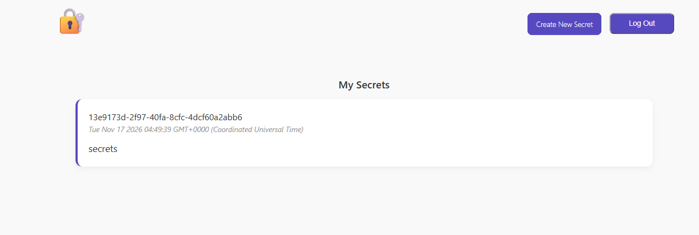
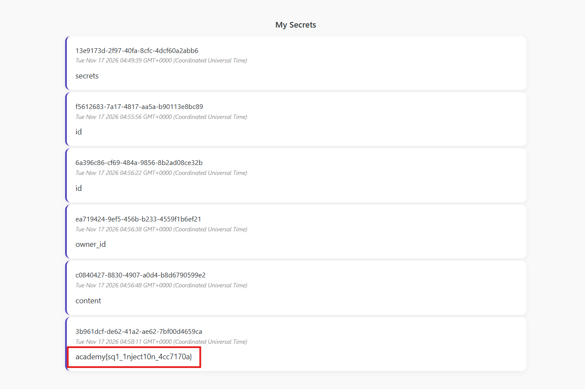

This secret box is designed to conceal your secrets. It's perfectly secure—only you can see what's inside. Or can you? Try uncovering the admin's secret.

  

# **Walkthrough**
### 1. Account Creation & Initial Enumeration
Register a new user account on the application using the credentials test / test (username: test, password: test).

Log in with the newly created account. On the home dashboard, navigate to the Create New Secret feature. To test how the backend handles user-supplied input, enter a single quote (') into the secret text box and intercept the request in Burp Suite.
Submitting a single quote triggers an HTTP 500 Internal Server Error. Because the unescaped quote breaks out of the SQL string literal and causes a syntax error in the underlying INSERT query (INSERT INTO secrets(owner_id, content) VALUES ('${userId}', '${content}')), this confirms the parameter is vulnerable to SQL injection.

  

  

### 2. Fingerprinting the Database Management System (DBMS)
Because the injected input is stored inside the secrets table and reflected back on the user's dashboard, we can use string concatenation payloads from the PortSwigger SQL Injection Cheat Sheet to identify the backend DBMS: https://portswigger.net/web-security/sql-injection/cheat-sheet
 
 Test String Concatenation: Submit the payload **te'||'st** into the secret field. The application saves and renders the concatenated string as test, confirming that || is evaluated as a string concatenation operator. This narrows the backend database down to Oracle or PostgreSQL.
   

Confirm PostgreSQL: Query the database version using PostgreSQL's version() function inside the pipe subquery: **'||(SELECT version())||'**
   
 
The application executes the subquery and displays the PostgreSQL version banner in the saved secret, confirming a PostgreSQL backend.

  

### 3. Database & Table Enumeration
With PostgreSQL confirmed, query information_schema.tables to map out the tables within the public schema. Because scalar subqueries used in string concatenation in PostgreSQL must return only a single column and a single row, use LIMIT 1 paired with OFFSET to iterate through the table names one by one:
First table (OFFSET 0): Returned users
Third table (OFFSET 2): Returned secrets

Payload: '||(SELECT table_name FROM information_schema.tables WHERE table_schema='public' OFFSET 2 LIMIT 1)||'

  

### 4. Column Enumeration & Flag Extraction
Next, enumerate the columns inside the secrets table by querying information_schema.columns (WHERE table_name='secrets') using LIMIT 1 and OFFSET to inspect each column name individually, revealing the content column.

Finally, extract the stored records from the content column of the secrets table (starting with the first row, which belongs to the admin):
Payload: '|| (SELECT content FROM secrets LIMIT 1) ||'

